# Claude Sessions

Widget macOS nổi luôn nằm trên cùng, hiện các session Claude Code đang mở trên máy: trạng thái, việc đang làm, PR, ticket, và các nút trả lời nhanh.

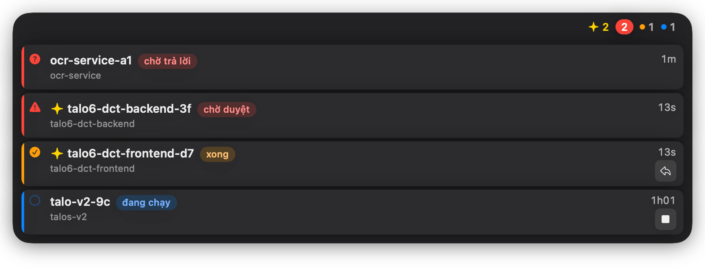

## Tính năng

### Danh sách mở rộng
Rê chuột vào viên thì mở danh sách các session, mỗi thẻ có icon trạng thái, tiêu đề kèm tag trạng thái (`chờ duyệt`, `chờ trả lời`, `xong`, `đang chạy`, `chờ N agent nền`, `chờ agent nền`, `chờ lệnh nền`), thư mục, vạch màu ở mép trái và cột phải cố định gồm thời gian và nút icon nhanh. Danh sách là một khung kính (vibrancy thật) rộng 560 pt, bo góc 20 pt, hiện ra bằng scale + mờ dần từ góc của viên (0.28 s, đóng 0.16 s). Header cao 38 pt gom quota `5h` / `Tuần` dạng vòng và số session theo nhóm màu, cả hai ở đầu phải để tai thỏ MacBook không che (vòng `5h` kèm `reset HH:mm` hoặc dự báo `hết ~HH:mm` màu đỏ, rồi tới vòng `Tuần`; hẹp thì ghi chú reset, rồi `Tuần` nhường chỗ). Session xếp trong các nhóm bo góc `Cần bạn`, `Xong`, `Đang chạy`; nút `Trả lời…` / `Dừng` chỉ hiện trên dòng đang rê chuột hoặc đang chọn bằng bàn phím; dòng đang chạy có thanh tiến độ mảnh kèm dòng task; PR của session nằm trong một danh sách bo góc, mỗi PR một mục cao 42 pt; bấm vào mục để mở PR. Câu hỏi của Claude hiện thành danh sách đánh số với đáp án dạng radio, mỗi đáp án có mô tả luôn hiện; nút chính (`Cho phép`, `Gửi`) là viên thuốc màu xanh dương, ô trả lời bo tròn với nút gửi tròn xanh.

### Phím tắt bàn phím
Bấm phím tắt mở widget (`⌃⌥Space`) thì thẻ được chọn bằng vòng viền trắng và điều khiển bằng bàn phím:

| Phím | Việc làm |
|---|---|
| `↑` / `↓` | chọn thẻ trước / sau |
| `↩` | nhảy tới pane cmux của thẻ (widget vẫn mở) |
| `A` | cho phép (chỉ khi thẻ chờ duyệt và lệnh đã hiện đủ) |
| `D` | mở ô lý do từ chối (chỉ ở thẻ đang hiện nút `Từ chối…`) |
| `R` | mở ô trả lời (session xong, chạy trong cmux) |
| `1`-`9` | chọn đáp án thứ n của câu hỏi (đánh số liên tục qua các câu hỏi) |
| `⌘↩` | gửi câu trả lời khi mọi câu hỏi đã có lựa chọn |
| `Esc` | đang gõ: thôi gõ (đóng ô, giữ chế độ bàn phím); không gõ: đóng widget và trả phím cho app trước |

Phím không áp dụng cho thẻ đang chọn thì kêu beep; phím không gán thì đi tiếp tới app đang dùng. Chế độ bàn phím chỉ bật khi bấm phím tắt mở widget (bấm khi widget đang mở do rê chuột thì chuyển sang chế độ bàn phím thay vì đóng; thẻ đóng khi bấm lại phím tắt, bấm `Esc`, hoặc chuột rời khung nếu chuột đã vào nó, còn thẻ mở bằng phím tắt mà chuột chưa vào thì giữ mở đến khi bấm phím tắt; bấm sang app khác chỉ kết thúc chế độ bàn phím, bấm phím tắt lần nữa (ví dụ sau khi `↩` nhảy sang cmux) thì bật lại); chỉ rê chuột thì không bao giờ lấy phím, và rê chuột vào widget khi đang gõ ở terminal không cướp phím.

### Viên thu gọn
Khi không rê chuột, widget chỉ là một viên kính cao 30 pt với số session theo nhóm (kính và nền của viên theo `Độ đậm nền` trong `Cài đặt` (chuột phải → `Cài đặt…`); 0% thì chỉ còn các con số): số session chờ nằm trong huy hiệu đỏ đặc, các nhóm khác (cam xong, xanh đang chạy) là chấm màu với số mờ hơn; nhóm vàng có icon sparkle là session có tin mới. Viên không bao giờ hiện quota (chỉ header của danh sách có); độ rộng viên chỉ phụ thuộc số session.


### Câu trả lời cuối của Claude
Session đã xong hoặc đang chờ hiện thêm câu trả lời cuối của Claude, đọc từ transcript, để nắm kết quả mà không cần mở terminal.

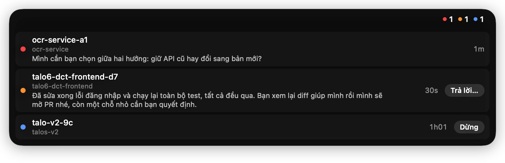

### Chờ duyệt
Session xin duyệt tool hiện lệnh hoặc file đang chờ, kèm nút `Cho phép` / `Từ chối…` để duyệt ngay trên widget.

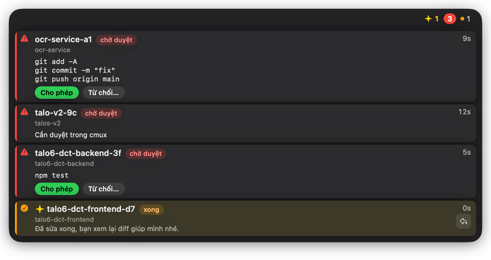

### Trả lời câu hỏi của Claude ngay trên widget
Khi Claude hỏi (AskUserQuestion), thẻ hiện câu hỏi và các lựa chọn; chọn xong bấm `Gửi` mà không cần quay lại terminal.

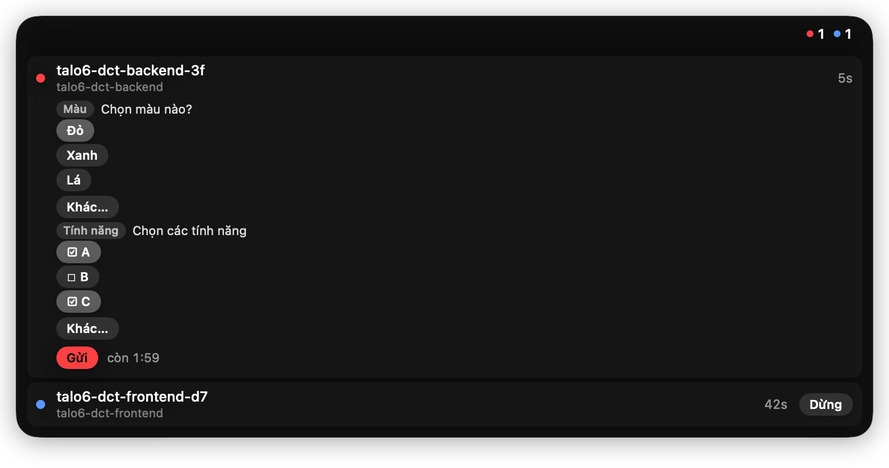

### Nút `Dừng`
Thẻ đang chạy có nút `Dừng` (hiện khi rê chuột hoặc chọn dòng bằng bàn phím); bấm lần đầu thì nút thành viên thuốc đỏ `Dừng?` ở cột thời gian, bấm lần hai để gửi Esc vào pane của session.

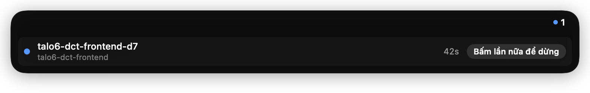

### Task đang làm
Session có task hiện dòng tiến độ `đã xong/tổng` cùng việc đang làm.

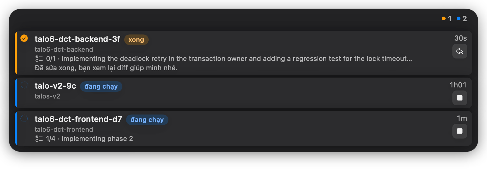

### Tiêu đề session
Tên dòng lấy từ tên đặt bằng `/rename`, tiêu đề AI hoặc prompt đầu tiên của session.

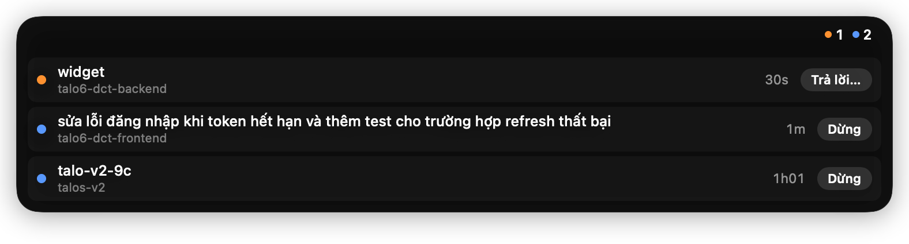

### Agent nền
Khi lượt chính đã xong mà agent nền còn chạy, thẻ hiện `chờ N agent nền` và đếm số agent. Khi file session bị ghi lại `busy` sau lượt đã xong mà không còn số đếm nào (ví dụ agent nền đã dừng chờ lệnh Bash nền của chính nó rồi chạy lại, Claude Code không đếm), thẻ hiện `chờ agent nền` với cùng icon, màu và nút như `chờ N agent nền`. Khi lượt chính xong mà còn lệnh Bash chạy nền (`status: "shell"`), thẻ hiện `chờ lệnh nền` (icon đồng hồ cát, màu `đang chạy`, nút `Trả lời…`).

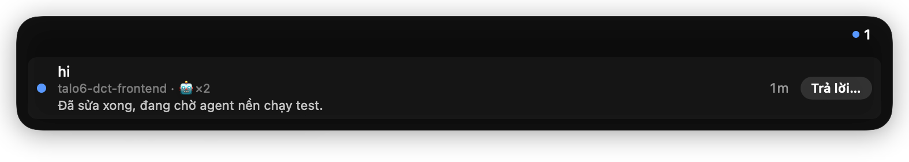

### Dòng PR Bitbucket
Các PR của session nằm trong một danh sách bo góc, nền hơi tối, đường kẻ mảnh giữa các mục. Mỗi PR là một mục cao cố định 42 pt dù hiện nút nào: bên trái là ô vuông nhỏ có icon PR tô theo trạng thái (mở xanh lá, đã merge chàm, đã đóng đỏ); dòng 1 là `#n` và tiêu đề (cắt bằng `…`, PR đã merge/đóng thì tiêu đề mờ hơn); dòng 2 là số yêu cầu sửa, số người duyệt, bình luận, trạng thái CodeRabbit, người review cuối và `cũ <thời gian>`. PR đã merge/đóng chỉ có chữ `đã merge` / `đã đóng` (xám) ở dòng 2 và không có nút. Nút `Nhắc duyệt` (xanh dương) và `Nhờ Claude` (để bảo Claude xử lý bình luận) nằm bên phải mục, căn giữa theo chiều dọc. Bấm vào chỗ nào của mục (trừ nút) cũng mở PR; rê chuột thấy tiêu đề đầy đủ. Các nút gửi hiện `Đang gửi…` rồi `Đã gửi ✓` hoặc `Lỗi — bấm thử lại` ngay trên nút trong 3 giây.

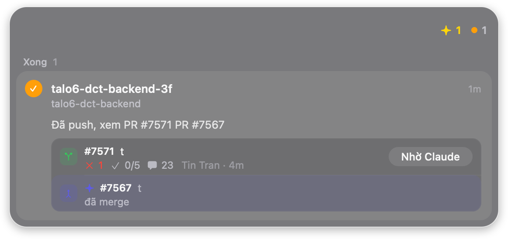

### CodeRabbit
PR hiện trạng thái review của CodeRabbit; khi còn thread góp ý chưa được trả lời, nhãn là `còn X/N` (ví dụ `còn 2/5`). Hết thread thì `chờ duyệt` kèm nút `Nhắc duyệt` và nút `Nhờ Claude` ẩn, trừ khi một build status không phải của CodeRabbit trên commit mới nhất của PR đang FAILED (pipeline lỗi): khi đó `Nhờ Claude` vẫn hiện. Thread mà CodeRabbit đã sửa gốc thành `✅ Addressed in commit …` tính là xong (bình luận được đọc lại tối đa 5 phút một lần khi còn thread chưa xong). Pipeline (build status không phải của CodeRabbit) trên commit mới nhất còn đang chạy hoặc đang lỗi thì status cũng được đọc lại 300 giây một lần, cả khi CodeRabbit đã xong. Bình luận của người review (không phải tác giả PR, không phải bạn) mà bạn chưa trả lời giữ nút `Nhờ Claude`. `đang nhắc` hết khi CodeRabbit đăng bình luận mới, cập nhật status, hoặc sau 600 giây. Lệnh duyệt thất bại (`Approval skipped: <lý do>` hoặc bình luận `approval failed`) hiện nhãn đỏ `duyệt lỗi`, rê chuột thấy lý do, không có nút `Nhắc duyệt`.

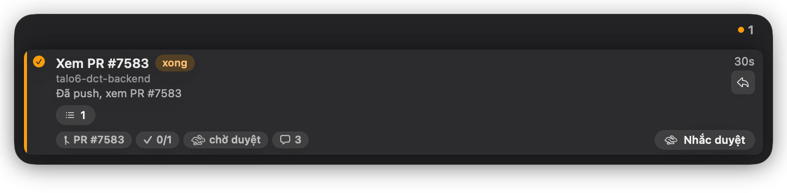

### Ticket Jira và link
Các ticket Jira và PR nhắc trong session thành chip bấm được (chip ticket tô màu theo trạng thái Jira); nút icon danh sách + `N` bung danh sách các mục còn lại ngay trong thẻ (mỗi mục hai dòng: tiêu đề, rồi mã và trạng thái).

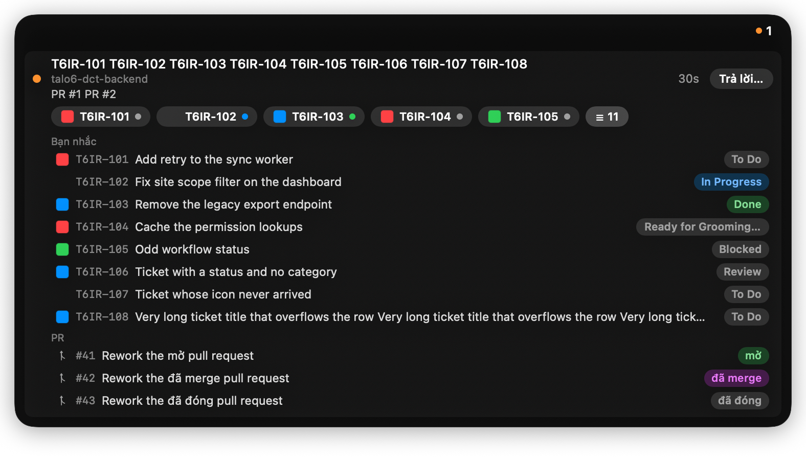

### Dấu tin mới
Session vừa chuyển từ đang chạy sang xong/chờ, hoặc PR có sự kiện, được đánh dấu bằng icon sparkle và nền ấm nhạt trên thẻ (hoặc tô tím ở mục PR, kèm icon sparkle trước `#n`) cho đến khi bạn xem.

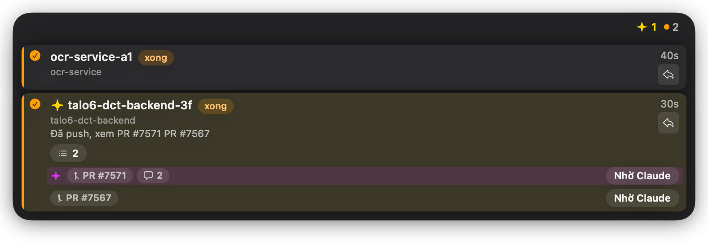

### Quota 5 giờ / tuần
Header hiện mức dùng quota của cửa sổ 5 giờ và của tuần, đổi màu khi gần hết, kèm dự báo giờ chạm 100% nếu tốc độ hiện tại giữ nguyên.

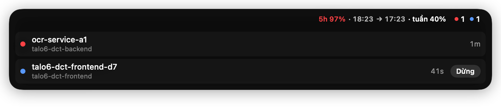

### Vừa đóng
Dòng gập `Vừa đóng` cuối danh sách liệt kê các session vừa kết thúc; bấm một dòng để mở lại bằng `claude --resume`.

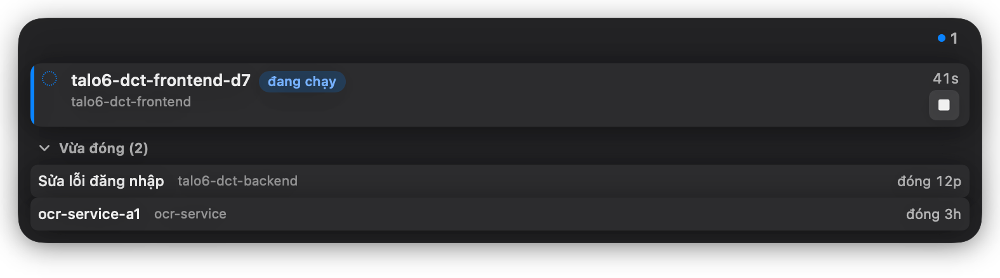

### Process do Claude start
Dev server, lệnh nền và MCP mà một session Claude Code start nhưng quên tắt được tìm theo `CLAUDE_CODE_SESSION_ID` trong env của process (quét mỗi 5 giây, bằng syscall, không chạy `ps`). Thẻ session đang sống hiện thêm `· :5173 :8080 ›` hoặc `· 2 lệnh nền ›` (gập mặc định), `· 2,6 GB` màu cam khi tổng RAM từ 2 GB và `· CPU cao` màu đỏ khi một nhóm quá 50% CPU suốt 60 giây. Session đã đóng mà còn process thì dòng `Vừa đóng` của nó giữ lại, hiện `N đang chạy · 886 MB ›` (tiêu đề `Vừa đóng` khi gập hiện chữ cam `· N đang chạy`, viên hiện chấm xám) và giữ đến khi hết process, không hết hạn sau 24 giờ và không bị cắt khi quá 5 dòng; dòng có chấm cam. Session widget chưa từng thấy mà còn process thì có dòng `chạy từ …` (bấm để resume trong thư mục của nó). Mở dòng thấy `Claude và MCP`, `N MCP và agent` và từng lệnh (`vite :5173 · 412 MB`, tooltip là lệnh gốc).

Tắt: rê chuột vào dòng, bấm `✕` rồi `Tắt` trong 3 giây (`✕` ở dòng con tắt cả nhóm process của nó, gồm lệnh Bash, vòng lặp shell và process phụ cùng nhóm; `Tắt N` ở dòng session đã đóng tắt mọi process của session đó; `Tắt cả N` ở tiêu đề `Vừa đóng`, hiện khi có từ 2 dòng còn process, tắt mọi process còn sót của mọi session đã đóng). `✕` đổi thành `Tắt` đỏ trong 3 giây. Widget chỉ tắt đúng process đang hiện (kiểm cả pid và giờ start), gửi `SIGTERM`, đợi 3 giây rồi `SIGKILL` các process còn sống; nút hiện `Đang tắt…`, nếu hệ thống từ chối thì hiện `Không tắt được`. Không bao giờ hiện thành dòng có nút tắt: MCP và `Claude và MCP` của session đang sống, process của một claude còn sống (ví dụ `claude -p`), lệnh ngắn hơn 5 giây, chính widget và process con của nó, process khởi động ngoài Claude.

Giới hạn: process chạy riêng từ binary hệ thống (ví dụ `sleep 600 &`, `caffeinate &`) không thấy được vì macOS giấu env của binary hệ thống; process binary hệ thống cùng nhóm với một process có thẻ (ví dụ vòng lặp shell bao quanh `node`) vẫn được hiện và bị tắt cùng nó.

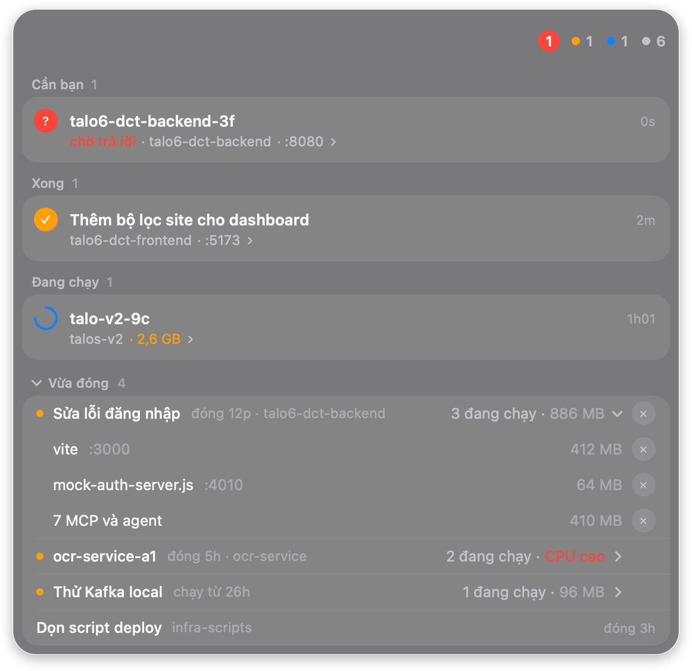

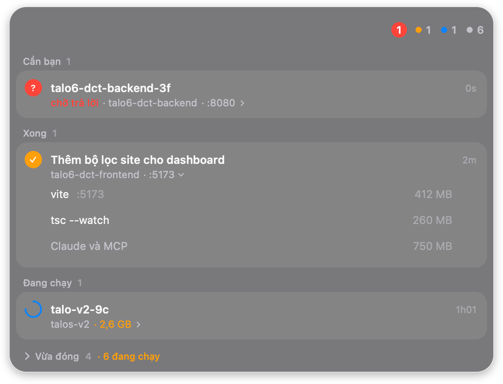

## Cài và chạy

```bash
bash ~/.claude/skills-repo/install.sh --only widget
```

Widget là một cargo workspace Rust: `crates/claude-sessions-core` (logic thuần), `crates/claude-sessions-macos` (AppKit), `crates/claude-sessions` (binary), `xtask` (bundle, dist). `install.sh` cài bản release ghim trong `claude-sessions/release.lock` và kiểm SHA-256 của nó. Tải tay: lấy `.dmg` ở trang GitHub Releases (tag `widget-vX.Y.Z`), kéo `ClaudeSessions.app` vào `~/Applications`; app ký ad-hoc nên lần mở đầu vào System Settings → Privacy & Security → `Open Anyway`. Build từ nguồn: `bash claude-sessions/build.sh` (cần `rustup`; chạy `cargo xtask bundle`). Đóng gói release: `cargo xtask dist --version X.Y.Z`. Dòng PR cần mục Keychain `bitbucket-api-token` (tuỳ chọn; không có thì widget chạy như cũ, không có PR). Nhập và kiểm tra token Jira/Bitbucket, chọn độ đậm nền, âm báo, phím tắt và sửa prompt `Nhờ Claude` trong cửa sổ `Cài đặt` (chuột phải → `Cài đặt…`, hoặc ⌘,).

## Test

```bash
cargo test --workspace                           # trong claude-sessions/; test GUI tự bỏ qua
CLAUDE_SESSIONS_GUI_TESTS=1 cargo test --workspace   # thêm test GUI offscreen (không mở cửa sổ)
bash perf.sh                                     # đo hiệu năng bản thật với ngưỡng cố định, cần tắt sandbox
```

Cờ môi trường khác (`CLAUDE_SESSIONS_FOCUS_TESTS`, `CLAUDE_SESSIONS_PERF_TESTS`): xem [README gốc](../README.md#widget-claude-sessions).

## Cập nhật ảnh

Ảnh minh hoạ sinh từ test snapshot GUI offscreen; chạy lại khi UI đổi:

```bash
bash claude-sessions/screenshots.sh   # render offscreen, không mở cửa sổ; cần ImageMagick (`magick`)
```

`closed-2-open` và `quota-3-high-forecast` có giờ theo đồng hồ thật nên đổi mỗi lần chạy lại.

## Chi tiết

Toàn bộ hành vi của widget nằm ở [README gốc](../README.md#widget-claude-sessions).
