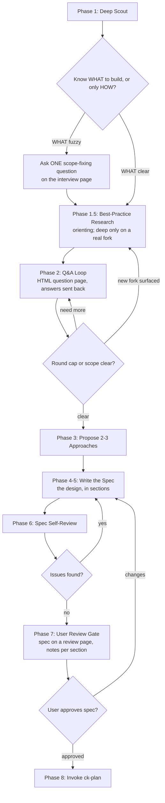

# Brainstorm Pro — Hybrid Skill

Combine the best parts of `ck:brainstorm` and `superpowers:brainstorming`:

- **From ck:** deep scout BEFORE any question, brutal honesty, brutal pushback on premise, terminal at `ck-plan`.
- **From superpowers:** one question per round, multi-choice with recommendation, sectioned design with per-section approval, spec self-review (4 checks), user review gate before plan.
- **New:** conditional best-practice research right after scout; mid-stream re-explore when an answer reveals a new direction; interview questions shown one at a time as a local HTML page that sends the answers back to Claude (copy-and-paste as the fallback).

## Core Principles

- **YAGNI / KISS / DRY** — every design decision must honour these.
- **Reuse over rewrite** — scout first; if a similar feature exists, design ON TOP of it, not next to it.
- **One round at a time** — never batch questions that depend on each other; follow-ups depend on prior answers.
- **Decide from the card** — each question goes on the interview page with the context, evidence, concrete examples and trade-offs the user needs to decide without reading the code or the chat.
- **Brutal honesty** — challenge the premise, the user's preferred option, and any unexamined assumptions.
- **Evidence over assumption** — never ask the user what the code already reveals.

## Hard Gate

This gate is a **precondition on implementation, not a ban on it.** Once it is satisfied, implementation proceeds automatically via the `ck-plan` → `cook` skill chain without a further permission prompt (see Phase 8).

Do NOT invoke any implementation skill, write any code, scaffold any project, or take any implementation action until you have:
1. Written the design as the spec, in sections, and self-reviewed it
2. Shown the spec on its review page, where every section takes the user's notes
3. The user has approved the written spec (Duyệt on the page, or an approving reply in chat)

This applies to EVERY project regardless of perceived simplicity. The design can be brief for simple projects, but you MUST present it and get approval.

## Anti-Rationalization

| Thought | Reality |
|---------|---------|
| "This is too simple to need a design" | Simple projects = most wasted work from unexamined assumptions. |
| "I already know the solution" | Then writing it down takes 30 seconds. Do it. |
| "Let me explore the code first" | Phase 1 IS exploration. Don't skip the structured scout. |
| "I'll just batch the questions" | Batching dependent questions breaks adaptive follow-up. Group only independent ones (up to 4 on one page). |
| "This one is quick, I'll ask it in chat" | Every interview question goes on the HTML question page. Chat carries the file path; the answers come back from the page (or pasted). |
| "A short question is easier to answer" | A short question makes the user reconstruct the context. Fill the card: why, evidence, example per option, pros/cons, recommendation. |
| "Skip scout, the ticket is detailed" | Tickets often miss existing infra. Scout anyway, briefly. |
| "User wants action, not talk" | Bad action wastes more time than good design. |
| "Just propose one approach" | Always 2-3. Lead with rec, but show alternatives. |
| "Research the best practice first, then scout" | Scout first — the repo may already solve it (reuse beats research) and you'd research the wrong stack. Best-practice research is Phase 1.5, AFTER scout. |
| "Deep-dive the pattern now, before Q&A" | If WHAT is still fuzzy you may deep-dive a direction the user descopes. Orient lightly; deep-dive only a real, still-open fork. |
| "The design is all in the spec now, so the review can be skipped" | The spec IS what the user approves, section by section on the review page (Phase 7). Writing it is not approving it. |
| "Duyệt came with notes, they can wait for the plan" | Notes sent with Duyệt are small fixes: apply them to the spec before invoking ck-plan. |
| "No open questions left, so nothing to wait for" | Having no *questions* is why you write the spec. It is not permission to hand it off. The user reviews the artifact, not your confidence in it. |
| "Phase 8 says invoke ck-plan immediately, so go" | "Immediately" means *in the same turn as the approval* — not *without* it. The sentence opens with "Once user approves the spec". |

## Process Flow (Authoritative)



If prose conflicts with this diagram, follow the diagram. Terminal state is the `ck-plan` skill — never any other implementation skill.

---

## Phase 1: Deep Scout (BEFORE asking anything)

The single highest-leverage step. Skipping or shortening this is the #1 mistake.

**Required actions:**
1. **Read `CLAUDE.md`** + any `.claude/rules/*.md` to internalize project conventions
2. **Identify related areas** in the codebase:
   - `ls` and `grep` related directories (`src/pages/`, `src/components/`, etc.)
   - Find existing similar features (search for keywords from the topic)
   - Read any relevant existing components / hooks / services
3. **Cross-repo scan** if the project has additional working directories (e.g. backend repo) — check there too
4. **Read related docs** in `docs/` if any
5. **List user memory** if available — past feedback informs design

**Scout output (keep in working memory):**
- "Existing infrastructure" summary: what already exists and could be reused
- "Reuse opportunities": specific files/functions/types to build on
- "Conflict risks": existing patterns this feature must respect
- "Open questions for user": gaps the code does NOT answer

**Cite scout evidence in later questions.** Never ask "what database does the project use?" if scout already showed it.

**Budget:** 5-15 actions typical. Stop when you have a clear picture of reuse landscape.

---

## Phase 1.5: Best-Practice Research (conditional, right after scout)

Two DIFFERENT kinds of research — don't conflate them:
- **Reuse research (internal)** = Phase 1 scout itself. Always first.
- **Best-practice research (external)** = how the wider world solves this (canonical libs, patterns, trade-offs). THIS phase.

**Default position: immediately after scout, before Q&A.** Knowing the solution space up front makes your questions sharper — you can only ask "time-based vs context-based coalescing?" if you already know both exist.

**The one exception — defer when intent is fuzzy.** After scout, run the discriminator:

> **"Do I already know WHAT I'm building, or only HOW?"**

- **WHAT is clear** (only "how" is open) → research now.
- **WHAT is fuzzy** (scope/intent unsettled) → ask ONE scope-fixing question FIRST, then research. Researching a moving target wastes the work — you may deep-dive a direction the user then descopes.

**Calibrate depth:**
- **Orienting pass (default):** just enough to know which approaches exist and which is canonical. Light.
- **Deep-dive:** exact API semantics, pattern comparison (e.g. command vs snapshot). Reserve for a fork that genuinely affects the design AND is still open. A deep-dive may also come LATER as a top-up if Q&A opens a new fork the orienting pass didn't settle (the Q&A↔Phase-3 hinge — see the diagram's loop back to 1.5).

**Only research at all when ALL three hold** (else skip — reuse or bespoke beats research):
1. Scout found NO in-repo precedent to copy (if there is one, reuse it — don't research).
2. The problem is well-trodden externally (undo/redo, caching, auth, retry, rate-limiting…) with canonical patterns.
3. The choice materially affects the design — a real fork, not a cosmetic detail.

Anchor findings to the design and cite them in the Phase 3 approaches. Prefer the codebase's own conventions + large-system precedents over novel invention.

---

## Phase 2: Q&A Loop (one round at a time, on the interview page)

**REQUIRED:** run the interview through `references/html-interview.md` — a local HTML page per
round opened in the browser, a full card per question, the answers sent back from the page (or pasted into chat).
The scope-fixing question (Q0) and the Phase 3 approach pick are asked the same way.

**Rules:**
- ONE round per page — one question, or up to 4 independent ones (no answer can change another's options or relevance). Open it, wait for the answers, then open the next. A question that depends on an answer waits for the next round
- 2-4 suggested options per question with **your recommendation** clearly marked, plus a **"Khác (tự nhập)" option on every question** for the user's own answer (the page adds it; in the chat fallback, list it yourself)
- Each question targets the **biggest current gap** in your understanding
- After each answer, decide: do I need to re-explore the code? If yes, mini-explore (1-3 actions) BEFORE the next question
- Brutal honesty injection: at least once during the loop, challenge the user's framing or preferred direction with a "what if X were not true?" question

**Question targeting (biggest gap first):**
| Gap | Sample Question |
|---|---|
| Goal unclear | "When you say 'audit log', what does an admin DO with it — verify integrity, debug user issues, satisfy compliance?" |
| Constraints unclear | "Volume: ~100 events/day or ~10k? Affects pagination strategy." |
| Success criteria unclear | "If I showed you the finished page, what would make you say 'yes, exactly'?" |
| Scope drift risk | "You mentioned X. Is that v1 or v2?" |

**Round cap: 8.** If still unclear at round 8, present what you have and ask the user to fill blanks directly. Do NOT spin past the cap.

**Scope check (continuous):** if the request describes 3+ independent subsystems (e.g. "platform with chat, billing, analytics"), STOP and help decompose into sub-projects. Each sub-project gets its own brainstorm cycle.

---

## Phase 3: Propose 2-3 Approaches

After Q&A, present 2-3 viable approaches as the last question on the interview page: one option
per approach (`means`, `example`, `pros`, `cons`, `effort`), the recommended one marked, the
reason in `recommendation`. In content terms:

```
**Approach A — [name]** (RECOMMENDED)
- Pros: ...
- Cons: ...
- Effort: low/medium/high

**Approach B — [name]**
- Pros: ...
- Cons: ...

**Approach C — [name]** (only if it adds new dimension)
- Pros: ...
- Cons: ...
```

Lead with your recommendation and the reason. If user prefers a non-recommended option, **brutally honest pushback** as the next question on the page (stage `Phản biện`: the risk you see, keep vs. switch) — but accept the user's call if they reconfirm with reason. Once the approach is settled, continue in chat.

---

## Phase 4: Sectioned Design (approved on the spec's review page)

Write the design straight into the spec (Phase 5), in its sections; the user approves it section by
section on the review page in Phase 7, where every `##` and `###` section takes a note. Do not
present the sections in chat first: one read of the spec replaces a chat round per section.

Design sections (scale each to its complexity — a few sentences if simple, 200-300 words if nuanced):
1. **Architecture** — high-level components and how they fit
2. **Components / Files** — concrete files to create/modify, REUSING existing infra from scout
3. **Data flow / Types** — request/response shapes, type contracts
4. **Risks & error handling**
5. **Testing & rollout** — what tests, what feature flag (if any), rollback strategy

---

## Phase 5: Write Spec

**Path:** `{plan-root}/{YYYY-MM-DD}-{kebab-slug}/spec.md`, where `{plan-root}` is the project's existing plan directory (`plans/`, else `ai_docs/`, else `docs/plans/`). Same directory ck-plan will resolve to, so the spec and the plan land together — see ck-plan's SKILL.md § "Plan Directory Resolution".

**NOT** `docs/superpowers/specs/` and **NOT** `.omc/specs/` — keep within the project's plan root for the ck-plan handoff.

**Spec structure** (a Google-style design doc with the bottom line first; the reader decides from the
first two sections whether to skim or read closely):
```markdown
# Spec: <chủ đề>

## Tóm tắt
- **Thay đổi:** what the user or system gets, in one line
- **Cách làm:** the chosen approach, in one line
- **Công sức:** phases, repos, size
- **Còn cần bạn quyết:** what needs the user, or "không"

## Cần bạn xem kỹ
1-3 places that most need the reader's judgement: hard-to-reverse choices, risks, assumptions.

## Bối cảnh
Today, with `file:line` evidence and the scout's reuse findings; no solution yet.

## Mục tiêu / Không làm

## Quyết định
The interview's picks, one row each (question, pick).

## Cách làm
The chosen approach and why, then a "Phương án đã loại" table (each alternative, including
"không làm", with one reason it lost).

## Thiết kế
### Kiến trúc              (a Mermaid diagram when there are 3+ parts)
### Thành phần / File      (create/modify, what changes, what it reuses)
### Luồng dữ liệu / Kiểu   (shapes, not full code; cite file:line)

## Rủi ro & xử lý lỗi

## Kiểm thử & triển khai

## Tiêu chí hoàn thành
- [ ] Concrete, testable items

## Còn mở
- Genuinely deferred decisions (with options to revisit)

## Phụ lục: File thay đổi
FE: ...
BE: ...
```

Write the spec in Vietnamese: the user reads it on the review page. Code, identifiers, file paths,
commands and text meant for Jira or a PR stay as they are. Each section opens with its conclusion.
Keep code short and cite `file:line`: the review page opens the file.

---

## Phase 6: Spec Self-Review (4 checks)

After writing, re-read the spec with fresh eyes:

1. **Placeholder scan** — any `TBD`, `TODO`, vague requirement? Fix inline or move to Open Items.
2. **Internal consistency** — do sections contradict each other? Architecture matches Components?
3. **Scope check** — focused enough for ONE implementation plan? Or needs decomposition?
4. **Ambiguity check** — any requirement interpretable two ways? Pick one, make explicit.

Fix issues inline. No re-review loop — fix and move on.

---

## Phase 7: User Review Gate

**This gate is not optional and cannot be waived by inference.**

After self-review, show the spec on its review page (`references/html-doc.md`), served from a
foreground `Bash` call with `timeout: 600000`:

```
node ~/.claude/skills/brainstorm-pro/assets/render-interview.mjs plans/{date}-{slug}/spec.md <scratchpad>/review-{slug}/review-NN.html --serve
```

- `Quyết định: Duyệt` → apply any notes to the spec, then Phase 8 in the same turn.
- `Quyết định: Sửa` → edit the spec as the notes ask, re-run Phase 6, show the next round
  (`review-NN+1.html`).
- Moved to the background after 10 minutes → end the turn with one line; the answer arrives as the
  task's notification. A reply in chat counts the same (stop the serve command).
- No browser (exit 4) → ask in chat: "Spec written to `plans/{date}-{slug}/spec.md`. Please review
  and let me know if you want any changes before we move to the implementation plan." and wait.

### What does NOT satisfy this gate

The only things that open it are the user's **Duyệt** on the spec's review page, or their approving
reply in chat, in this conversation, after the spec file exists. None of the following count — each is a real way this gate has been
skipped by mistake:

- **"Skip presenting the sections"** / "no need to walk me through it" → that is **Phase 4**. It
  means *stop narrating the design section by section*, not *stop letting me read the spec*. The
  user is asking for fewer intermediate summaries and MORE reliance on the written artifact — which
  makes Phase 7 more important, not less.
- **A question answered on the interview page** — that settled one decision, not the spec.
- **"No open questions left"** — that is the precondition for writing the spec, not for shipping it.
- **A standing preference to auto-run `cook`** — that governs the plan→implementation handoff
  *after* this gate, never the spec→plan one.
- **The spec looking obviously right to you.** Self-review is Phase 6 and it already happened. Phase
  7 exists because the author is the worst reviewer of their own scope calls.

If the user has genuinely pre-authorized skipping this ("just build it", "don't wait for me"), quote
the words they used when you proceed, so the assumption is visible and correctable.

---

## Phase 8: Terminal — Invoke ck-plan (which runs on into cook)

**Precondition: Phase 7 passed — the user approved the spec (Duyệt on its review page, or a reply in
chat).** If you cannot point to that answer, you are not in Phase 8. Go back and ask.

Once user approves the spec, invoke the `ck-plan` skill immediately (`Skill` tool, `skill: "ck-plan"`) — same turn, no confirmation prompt.
"Immediately" qualifies *when* the handoff happens relative to the approval, never *whether* the
approval was needed:

```
ck-plan reads plans/{date}-{slug}/spec.md as requirements,
SKIP scout/discovery (already done in this brainstorm),
create phase files in the same plan directory.
```

Do NOT invoke `writing-plans`, `frontend-design`, `mcp-builder`, or any other implementation skill. The ONLY skill invoked after this brainstorm is `ck-plan`.

### The chain does not stop at the plan

`ck-plan` ends by auto-invoking `cook`, which implements the plan through subagents. **That is intended and pre-authorized.** Approving the spec at Phase 7 is the user approving the whole chain: spec → plan → implementation.

Do NOT do any of these after handing off to `ck-plan`:
- Stop at the written plan and ask "should I implement now?" / "run cook?"
- Print `/cook {path}` for the user to run themselves.
- Treat this skill's own "no implementation code written" rule as blocking cook — that rule governs Phases 1–7 only, and Phase 7 has already passed by the time `ck-plan` is invoked.
- Treat a standing "do not call the AgentTool / do not use subagents / do not use workflows unless the user requested it" instruction as blocking cook. Running this skill to spec approval **is** that request. See ck-plan's SKILL.md § "The handoff is not gated by subagent restrictions".

The only thing that stops the chain at the plan is the user explicitly saying so in their own words ("just plan", "don't implement yet", `--plan-only`) during *this* conversation.

---

## Tool Usage

- `Read` / `Glob` / `Grep` for scout (Phase 1)
- `Bash` for `ls`, `find`, `git log` etc. during scout
- `context7` (library docs), `WebSearch`, or a `document-specialist` sub-agent for Phase 1.5 best-practice research
- `Write` (question JSON) + `Bash` (`render-interview.mjs --serve` in the foreground, 10-minute timeout, same message) for every interview question (Q0, Phase 2, Phase 3) — `references/html-interview.md`; chat only as its fallback
- Sub-agents OK for parallel research IF Phase 1 reveals multiple unknown areas — but keep it focused
- `Write` to save spec in Phase 5; `Bash` (`render-interview.mjs <spec.md> … --serve`, foreground, 10-minute timeout) to show it in Phase 7 — `references/html-doc.md`
- `Skill` to invoke `ck-plan` in Phase 8

## Examples

### Good — scout citation
```
[Phase 1 found existing PatientAudit entity + AuditLogService gateway]

Round 2: "I found PatientAudit BE entity and AuditLogService FE gateway in
src/gateways/AuditLogService.ts. The new feature can extend the existing
search criteria. Should we reuse the existing gateway or create a new
admin-scoped one?"
```

### Good — brutal honesty pushback
```
User: "I want a separate audit log table for this feature."
Response: "Pushback — there's already a PatientAudit table with the schema
you'd need. Adding a parallel table violates DRY and creates two sources
of truth for the same concept. Strong recommendation: extend PatientAudit
with the missing fields. Are there specific reasons the existing table
won't work?"
```

### Bad — batching
```
"What's the audience? Where should it appear? What events? What retention?"
```
Why bad: 4 questions whose answers shape each other (the audience decides where it appears and which events matter) break adaptive follow-up.

### Bad — asking what scout could answer
```
"What database does the project use?"
```
Why bad: scout would reveal `TypeORM` instantly. Wastes a round.

## Escalation

- **User says "just code it"** → respect; offer minimal "5-line spec" alternative, ask one final confirmation, then go to `ck-plan`.
- **Topic too large** → decompose into sub-projects; brainstorm only the first.
- **Scope keeps drifting** → freeze scope explicitly; document drifted items as v2/Open Items.
- **No clear recommendation possible** → present approaches with trade-offs, ask user to pick, do NOT push.

## Final Checklist

- [ ] Phase 1 scout actions logged (≥5 actions; cited in later questions)
- [ ] Phase 1.5 best-practice research done right after scout when warranted (all 3 conditions), or consciously skipped (reuse/bespoke/no real fork); deep-dive reserved for a real open fork
- [ ] Q&A respected one-per-round rule, max 8 rounds
- [ ] Every interview question (Q0, Q&A, approach pick) went on the interview page as a full card (why, context with evidence, options with example/pros/cons, recommendation); each answer taken from the page's reply (or the user's pasted one) before the next question
- [ ] Mid-stream re-explore happened at least once if answer reshaped scope
- [ ] At least one brutal honesty pushback on premise/assumption
- [ ] 2-3 approaches presented with trade-offs + recommendation
- [ ] Design written into the spec's sections, not presented section by section in chat
- [ ] Spec written to `plans/{date}-{slug}/spec.md`
- [ ] Spec self-review completed (4 checks)
- [ ] Spec shown on its review page (`--serve`); notes applied; the user approved it — you can quote the Duyệt or the reply
- [ ] Terminal: `ck-plan` invoked with spec path + skip scout/discovery instruction
- [ ] No implementation code written *before* Phase 7 approval (after it, `ck-plan` → `cook` implements — do not stop to ask)
- [ ] Did NOT stop at the written plan to ask permission to run cook
- [ ] No other implementation skill invoked

Topic: {{ARGUMENTS}}
