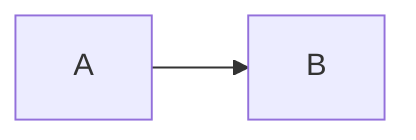

# Sample Spec

An intro paragraph before the first section, with a few plain words.

## Overview

The overview paragraph points at `fixtures/code.ts:2-4` and at [the code file](code.ts) for details.

### Goals

- first goal bullet with some words
- second goal bullet with more words
- third goal bullet with other terms

### Non-goals

1. numbered one is out of scope
2. numbered two is also out

## Design

| Name | Role |
|---|---|
| alpha | first role |
| beta | second role |

```ts
const first = 1;
const second = 2;
```



### Components

A paragraph under the components heading.

## Added

A brand new section.

## Open

The first open question was reworded here.

The second open question follows it.
