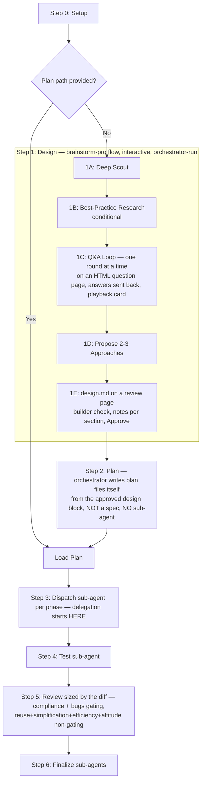

<SUBAGENT-STOP>
If you were dispatched as a subagent to execute a specific task, do not follow this skill:
finish the task you were given and report back.
</SUBAGENT-STOP>

# Cook - Smart Feature Implementation

End-to-end implementation. Every implementation phase is executed by a dedicated sub-agent (no in-line implementation by the orchestrator).

**Principles:** YAGNI, KISS, DRY | Token efficiency | Concise reports

## Usage

```
/cook <natural language task OR plan path>
```

- **Plan path given** (`plan.md` / `phase-*.md`) → load it, skip Steps 1–2, start at Step 3.
- **No plan** → Step 1 runs `references/design-phase.md`, which runs the shared `~/.claude/skills/brainstorm-pro/references/design-flow.md` in-line (deep scout →
  best-practice research → one-round-at-a-time Q&A on a local HTML question page → 2-3
  approaches → the design written to `design.md` and approved on a local review page, with notes per section). Where brainstorm-pro would write `spec.md` and hand off to `ck-plan`,
  cook instead goes straight to Step 2 (write the plan) and executes it in the same run.

**Example:**
```
/cook "Add user authentication to the app"
/cook plans/2026-01-20-auth/plan.md
```

<HARD-GATE>
Do NOT write implementation code until a design has been approved (Step 1) and a plan exists (Step 2).
This applies regardless of task simplicity. "Simple" tasks are where unexamined assumptions waste the most time.
User override: If user explicitly says "just code it" or "skip planning", respect their instruction —
collapse Step 1 to a minimal scout + one confirmation (see `references/design-phase.md` § Escalation).
A bug fix handed off by `routing-bug-fixes-to-cook` collapses Step 1 the same way (same § Escalation), except that its one confirmation is the fix pick on the interview page.
</HARD-GATE>

<HARD-GATE>
Steps 1 and 2 are NOT delegated. Scout, Q&A and the design review are conversational, and the plan is
written by the orchestrator itself — it holds the full design conversation in context, so handing it
to a sub-agent only loses fidelity. 1A's code reading runs in `explore` (Sonnet) per `../brainstorm-pro/references/design-flow.md` Phase 1 while the orchestrator keeps synthesis; research sub-agents may assist in 1B; the 1E builder check agent (`../brainstorm-pro/references/builder-check.md`) is the only other exception. Never write `spec.md`, never invoke the `ck-plan` skill, and
never dispatch a `planner` sub-agent — the approved design goes straight into plan files the
orchestrator writes with Write. Sub-agent delegation starts at Step 3 (execution).

**The plan FORMAT is `ck-plan`'s, though.** Before writing Step 2's files, load
`../ck-plan/references/plan-writing.md`, `../ck-plan/references/plan-organization.md` and `../ck-plan/references/output-standards.md`, then
match them: same plan-directory naming, same frontmatter schema, same `plan.md` skeleton, same
phase-file section set. Borrowing the format is not delegation — the orchestrator still types every
file itself. Cook-specific mapping and carve-outs: `references/workflow-steps.md` § Step 2.
</HARD-GATE>

<HARD-GATE>
The orchestrator NEVER edits source files itself during Step 3. Every phase MUST be dispatched to a sub-agent via the `Agent` tool (named `Task` in some harnesses). If you find yourself about to call Edit/Write for production code, STOP and dispatch a sub-agent instead. Committing a phase's files (`git add`/`git commit`) is bookkeeping, not editing; the orchestrator never runs a git command that changes file content. One exception, in Step 6 only: the fetch + merge (and `git merge --abort` on a conflict) the user's push rules require before a push (`references/workflow-steps.md` § Step 6).
</HARD-GATE>

## Anti-Rationalization

| Thought | Reality |
|---------|---------|
| "This is too simple to plan" | Simple tasks have hidden complexity. Plan takes 30 seconds. |
| "I already know how to do this" | Knowing ≠ planning. Write it down. |
| "Let me just start coding" | Undisciplined action wastes tokens. Plan first. |
| "Just one small edit, no need for a sub-agent" | Every implementation phase goes through a sub-agent. No exceptions. |
| "I'll plan as I go" | That's not planning, that's hoping. |
| "Just this once" | Every skip is "just this once." No exceptions. |
| "Cook never stops for the user, so skip the Q&A" | The no-stop rule starts at Step 2. Step 1 is interactive by design. |
| "The task is clear, skip scout and go straight to planning" | Scout is what makes the plan reuse existing infra instead of duplicating it. |
| "Batch the design questions to save turns" | Batching dependent questions breaks adaptive follow-up. Only independent ones share a page (up to 4). |
| "This design question is quick, ask it in chat" | Every 1C question and the 1D approach pick go on the interview page (`../brainstorm-pro/references/design-flow.md` § Phase 2). |
| "Write spec.md first, then plan from it" | No spec and no ck-plan in cook. The design lives in `<plan-dir>/design.md`, which `plan.md` links. |
| "Let a `planner` sub-agent write the plan" | No. The orchestrator writes the plan itself — it holds the design conversation. Sub-agents start at Step 3. |
| "Cook forbids invoking ck-plan, so its format doesn't apply either" | Delegation is forbidden; the format is shared. Load ck-plan's `plan-writing.md` + `plan-organization.md` + `output-standards.md` and match them. |
| "I'll write the plan free-form — cook is the only reader" | Wrong. Step 5 Section A and every ck-plan subcommand (`red-team`, `validate`, `archive`) read these files. Frontmatter + Phases table + per-phase sections are mandatory. |
| "`ck plan check` will tick the phases for me" | There is no `ck` CLI. Status updates are plain Edit calls on the Status cell and the phase-file checkboxes. |
| "Writing the plan counts as 'the orchestrator never edits files'" | That gate covers PRODUCTION code in Step 3. Plan files under `plans/` are the orchestrator's own output. |
| "I'll update the task list at the end" | No. Update `in_progress`/`complete` around EVERY phase, in the same turn. Batching = stale board. |
| "The phase is obviously done, no need to mark it" | Un-marked = not done. Update the task status before moving on. |
| "A cleanup finding looks serious, so block Step 6 on it" | Only Section A ❌ and Section B Critical/High gate. If a cleanup lens found a real defect, re-file it under Section B — don't smuggle a gate in through the cleanup bucket. |
| "Tests were green before the cleanup, so they're green after" | Cleanup edits change working code. Re-run tests AND the project verification gate, every fix batch. |
| "Re-run the reviewers each cycle" | No. The cleanup lenses run once, on cycle 0. Only the gating reviewer re-dispatches, scoped to the fix. |
| "Four lenses means four agents" / "Reuse is search-heavy, give it its own agent" | No — one cleanup agent holds all four lenses, Reuse pass first. A separate Reuse agent searched no more than the other cleanup agent and re-reported a third of its findings, leaving the orchestrator to dedup them from summaries. |
| "This simplification is obviously better than the repo's convention" | The convention wins. Some invariants look redundant on purpose and say so in CLAUDE.md. Report the tension, don't 'fix' it. |

## Process Flow (Authoritative)



**This diagram is the authoritative workflow.** Prose sections in `references/workflow-steps.md` provide detail for each node, and `references/design-phase.md` details Step 1. If prose conflicts with this flow, follow the diagram.

## Workflow Overview

```
[Setup] → [Design: scout → research → Q&A → approaches → design.md reviewed on a page] → [Plan: orchestrator writes it] → [Phase sub-agents] → [Test sub-agent] → [Review: sized by the diff (workflow-steps.md § Step 5) — compliance+bugs / reuse+simplification+efficiency+altitude] → [Finalize sub-agents]

Steps 1–2 are orchestrator-run (design + plan; except 1A's `explore` scout and the 1E builder check agent). Steps 3–6 are sub-agent-run (execution).
```

Step 1 is interactive (Q&A rounds, the design review page). **From Step 2 onward the workflow runs straight through without stopping for approval** (exceptions: SKILL.md § Gates). **Claude Tasks (ALWAYS create AND update):** A task list MUST always be created — use `TaskCreate` to seed tasks up front — AND MUST be kept in lock-step throughout: `TaskUpdate` → `in_progress` before each phase dispatch, `TaskUpdate` → `complete` once its report passes the check and its commit lands, or nothing is left to commit (`references/workflow-steps.md` § Report check, status and commit; one phase at a time, same turn — never batched to the end). **Fallback:** `TaskCreate`/`TaskUpdate`/`TaskGet`/`TaskList` are CLI-only — unavailable in the VSCode extension. If they error, still create AND update the list via `TodoWrite`. Never skip creating or updating the task list.

## Step Output Format

```
✓ Step [N]: [Brief status] - [Key metrics]
```

## Gates

**Step 1 has real gates** (it is a design conversation): one round at a time on the HTML question page during 1C (independent questions may share a page; the 1D approach pick too), the playback card round (end of 1C), the builder check's round (1E, only when it has questions for the user), and the user's approval of `design.md` on its review page in 1E (notes per section). Do not shortcut them.

**No approval stops from Step 2 onward**, with two exceptions: a hard-to-change NEEDS_CONTEXT question in Step 3 (`workflow-steps.md` § Report check, status and commit), asked while independent phases keep running, and the Step 6 push question (one per repo), with its follow-up when the pre-push merge refuses to start or conflicts. Plan → implement → test → review → finalize runs end to end without pausing for the user. Report progress as you go (`✓ Step [N]: …`) so the user can interrupt if they want to redirect, but never block waiting for a go-ahead. In particular, once implementation and testing finish, go straight into the review in the same turn.

The review (Step 5) is **sized by the diff** (workflow-steps.md § Step 5: one reviewer for a small diff, else a **single fan-out of two sub-agents in one message**): on a large diff agent 1 returns the dual-section gating report — (A) plan-compliance vs the acceptance criteria carried into `plan.md` from the approved design and per-phase "Done when" blocks, (B) severity-rated bugs — while agent 2 runs the four cleanup lenses borrowed from the `simplify` skill (Reuse first, then Simplification, Efficiency and Altitude) in one head, so it can collapse findings that are really one change at the mechanism level; on a small diff the single reviewer returns both, with the lenses as a non-gating Cleanup section. Re-reviews after a fix batch cover only the fix. Section A verdicts are non-overridable and Section B Critical/High gate; **cleanup findings never gate and never increment the cycle counter.** After any fix batch, re-run the tests AND the project's verification gate — cleanup edits touch working code.

**Always enforced:**
- **Testing:** 100% pass required (a failure confirmed on the Step 3 start commit excepted, `references/workflow-steps.md` § Step 4)
- **Code Review:** after the reviewers report, dedup, apply the findings worth applying and record which you skipped and why in the final report's `## Claude's calls` (Claude tự quyết) — do not stop to ask permission first
- **Commits:** one commit per phase and per fix batch, made by the orchestrator, never squashed (`references/workflow-steps.md` § Report check, status and commit)
- **Re-verify after cleanup:** any applied cleanup fix is followed by the test command AND the project's own verification gate, i.e. whatever command its CLAUDE.md declares must stay green (`pnpm verify` in talos-v2). A quality pass that ships a regression is worse than no quality pass
- **Finalize (MANDATORY - never skip):**
  1. `executor` subagent → run full plan sync-back (all completed tasks/steps across all `phase-XX-*.md`, not only current phase), then update `plan.md` status/progress
  2. `writer` subagent → update `./docs` if changes warrant; the prompt carries the Report contract, then the `references/subagent-patterns.md` § Every prompt lines, and its files are committed
  3. `TaskUpdate` → mark all Claude Tasks complete after sync-back verification (or `TodoWrite` if Task tools unavailable)
  4. Ask on the interview page (`../brainstorm-pro/references/html-interview.md`), not in chat, whether to push; the orchestrator pushes, never squashes. Then the final report with `## Claude's calls` (`references/workflow-steps.md` § Final report)

## Required Subagents (MANDATORY)

| Phase | Subagent | Requirement |
|-------|----------|-------------|
| Step 1 Design (1A–1E) | **orchestrator-run** (builder check agent in 1E) | Skip only if plan path provided. `explore` (Sonnet, required for 1A's reading, not in the collapsed Step 1 of § Escalation: its minimal scout stays inline); `document-specialist` optional in 1B; the builder check agent per `../brainstorm-pro/references/builder-check.md` in 1E |
| Step 2 Plan | **none — orchestrator-run** | Orchestrator writes `plan.md` + `phase-XX-*.md` itself with Write, in **`ck-plan`'s format** (load `../ck-plan/references/plan-writing.md` + `plan-organization.md` + `output-standards.md` first). Skip only if plan path provided. Dispatching `planner` here is FORBIDDEN |
| Implementation (per phase) | `executor` (or `designer` for frontend) | **MUST** spawn one per phase. Dispatch with `model: "sonnet"`. Prompt carries the Report contract, then the `references/subagent-patterns.md` § Every prompt lines |
| Testing | `test-engineer`, `debugger` | **MUST** spawn. Dispatch with `model: "sonnet"` |
| Review (compliance + bugs + cleanup) | `code-reviewer` (1 or 2, sized by the diff) | **MUST** spawn. Small diff: one reviewer, gating report + non-gating Cleanup (sized by the diff, workflow-steps.md § Step 5). Large: both in ONE message — agent 1 = dual-section gating report; agent 2 = Reuse+Simplification+Efficiency+Altitude (non-gating). Dispatch with `model: "opus"` |
| Fix application | `code-simplifier` (cleanup-only batch) / `executor` / `debugger` | Dispatch with `model: "sonnet"`. Prompt carries the Report contract, then the `references/subagent-patterns.md` § Every prompt lines |
| Finalize | sync-back (`executor`), docs (`writer`) | **MUST** spawn both. Dispatch each with `model: "sonnet"`. The orchestrator commits and pushes |

**Agent names are per-session.** Verify each type against the session's agent registry before
dispatching and fall back rightward; never abandon a step because a name is missing. Full mapping
table: `references/subagent-patterns.md`.

## Phase Dispatch Rules

- **One sub-agent per phase.** Each `phase-XX-*.md` file maps to exactly one `Agent` invocation.
- **Independent phases run in parallel.** When phases share no file ownership, dispatch them in a single message with multiple `Agent` tool calls.
- **Dependent phases run sequentially.** Wait for the prerequisite phase to return before dispatching the next.
- **File ownership boundaries.** The orchestrator computes file ownership from the plan and passes it explicitly to each sub-agent so concurrent agents do not collide.
- **Plan parsing.** Read each phase file once, extract scope/files/acceptance criteria, embed into the sub-agent prompt. Do not paraphrase — pass through verbatim where possible, plus `plan.md`'s `## Global Constraints` (`references/workflow-steps.md` § Step 3).

## References

- `references/design-phase.md` - Step 1 design flow (brainstorm-pro, in-line)
- `../brainstorm-pro/references/design-flow.md` - the shared design flow Step 1 runs
- `references/workflow-steps.md` - Detailed step definitions
- `references/review-cycle.md` - Review-fix cycle (runs without approval stops)
- `references/subagent-patterns.md` - Subagent invocation patterns

**Borrowed from `ck-plan` (Step 2 plan format — read before writing plan files):**
- `../ck-plan/references/plan-writing.md` - plan.md and phase-file templates, phase sizing, step rules, the shared self-review
- `../ck-plan/references/plan-organization.md` - plan dir naming + layout, file creation order and the Phases table, status-update rules
- `../ck-plan/references/output-standards.md` - frontmatter schema + auto-population, tag vocabulary, writing style
