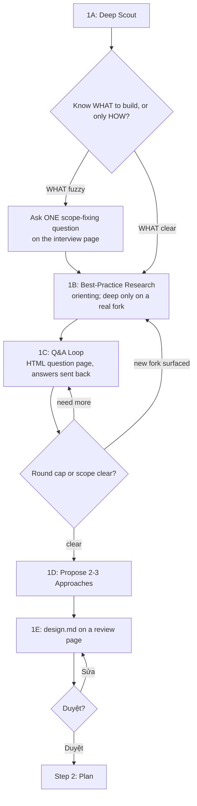

# Step 1: Design (brainstorm-pro flow, in-line)

Runs ONLY when no plan path was provided. This is the `brainstorm-pro` flow verbatim through
its design stage — deep scout → best-practice research → one-question-at-a-time Q&A →
2-3 approaches → the design written to `design.md` and approved on a review page.

**Terminal difference vs `brainstorm-pro`:** where brainstorm-pro writes `spec.md` and hands
off to `ck-plan`, cook writes the design to `<plan-dir>/design.md` and, once the user approves it,
goes to Step 2, where the **orchestrator itself** writes the plan files next to it (no `planner`
sub-agent), and execution continues in the same run.

**The orchestrator runs this step itself** — scout/Q&A/design are conversational and must not
be delegated. Sub-agents are allowed only as parallel research helpers inside 1A/1B.

## Core Principles

- **YAGNI / KISS / DRY** — every design decision must honour these.
- **Reuse over rewrite** — scout first; if a similar feature exists, design ON TOP of it.
- **One round at a time** — never batch questions that depend on each other; follow-ups depend on
  prior answers.
- **Decide from the card** — each question goes on the interview page with the context, evidence,
  concrete examples and trade-offs the user needs to decide without reading the code or the chat.
- **Brutal honesty** — challenge the premise, the user's preferred option, unexamined assumptions.
- **Evidence over assumption** — never ask the user what the code already reveals.

## Anti-Rationalization (design step)

| Thought | Reality |
|---------|---------|
| "This is too simple to need a design" | Simple tasks = most wasted work from unexamined assumptions. |
| "I already know the solution" | Then writing it down takes 30 seconds. Do it. |
| "Cook is supposed to run without stopping" | The no-stop rule starts at Step 2. Step 1 is interactive by design. |
| "I'll just batch the questions" | Batching dependent questions breaks adaptive follow-up. Group only independent ones (up to 4 on one page). |
| "This one is quick, I'll ask it in chat" | Every interview question goes on the HTML question page. Chat carries the file path; the answers come back from the page (or pasted). |
| "A short question is easier to answer" | A short question makes the user reconstruct the context. Fill the card: why, evidence, example per option, pros/cons, recommendation. |
| "Skip scout, the ticket is detailed" | Tickets often miss existing infra. Scout anyway, briefly. |
| "Just propose one approach" | Always 2-3. Lead with rec, but show alternatives. |
| "Research the best practice first, then scout" | Scout first — the repo may already solve it. Research is 1B, AFTER scout. |
| "Deep-dive the pattern now, before Q&A" | If WHAT is fuzzy you may deep-dive a direction the user descopes. |
| "Design approved, let me start editing files" | No. Write the plan yourself first (Step 2), then dispatch sub-agents. |
| "Design approved, hand it to `planner`" | No `planner` in cook. You held the conversation, so you write the plan. |

## Flow



---

## 1A: Deep Scout (BEFORE asking anything)

The single highest-leverage step. Skipping or shortening this is the #1 mistake.

**Required actions:**
1. **Read `CLAUDE.md`** + any `.claude/rules/*.md` to internalize project conventions.
2. **Save the Jira stories** when the topic names Jira issues (not in the collapsed bug-fix Step 1): run `../brainstorm-pro/references/jira-snapshot.md` (Sonnet agents in the background; it keeps Story/Epic only). Read their one-line reports, then the saved files of the stories you design.
3. **Identify related areas** in the codebase: `ls`/`grep` related directories, find existing
   similar features (search keywords from the topic), read relevant existing
   components / hooks / services.
4. **Cross-repo scan** if the project has additional working directories (e.g. backend repo).
5. **Read related docs** in `docs/` if any.
6. **List user memory** if available — past feedback informs design.

**Scout output (keep in working memory, carry into Step 2):**
- "Existing infrastructure" — what already exists and could be reused
- "Reuse opportunities" — specific files/functions/types to build on
- "Conflict risks" — existing patterns this feature must respect
- "Open questions for user" — gaps the code does NOT answer

**Cite scout evidence in later questions.** Never ask "what database does the project use?"
if scout already showed it.

**Budget:** 5-15 actions typical. `document-specialist` / `Explore` sub-agents may be dispatched in
parallel for distinct areas (reports ≤150 lines); the orchestrator still owns synthesis.

**Output:** `✓ Step 1A: Scout complete - [N] actions, [M] reuse opportunities`

---

## 1B: Best-Practice Research (conditional, right after scout)

Two DIFFERENT kinds of research — don't conflate them:
- **Reuse research (internal)** = 1A scout itself. Always first.
- **Best-practice research (external)** = how the wider world solves this. THIS step.

**Default position: immediately after scout, before Q&A.** Knowing the solution space up front
makes your questions sharper.

**The one exception — defer when intent is fuzzy.** After scout, run the discriminator:

> **"Do I already know WHAT I'm building, or only HOW?"**

- **WHAT is clear** (only "how" is open) → research now.
- **WHAT is fuzzy** (scope/intent unsettled) → ask ONE scope-fixing question FIRST, then research.

**Calibrate depth:**
- **Orienting pass (default):** just enough to know which approaches exist and which is canonical.
- **Deep-dive:** exact API semantics, pattern comparison. Reserve for a fork that genuinely
  affects the design AND is still open. May also come LATER as a top-up if Q&A opens a new fork.

**Only research at all when ALL three hold** (else skip):
1. Scout found NO in-repo precedent to copy.
2. The problem is well-trodden externally (undo/redo, caching, auth, retry, rate-limiting…).
3. The choice materially affects the design — a real fork, not a cosmetic detail.

Anchor findings to the design and cite them in the 1D approaches. Prefer the codebase's own
conventions + large-system precedents over novel invention.

**Output:** `✓ Step 1B: Research [done - N sources | skipped - <reason>]`

---

## 1C: Q&A Loop (one round at a time, on the interview page)

**REQUIRED:** run the interview through `../brainstorm-pro/references/html-interview.md`
(relative to the cook skill directory) — a local HTML page per round opened in the browser, a
full card per question, the answers sent back from the page (or pasted into chat). The scope-fixing question (Q0) and the
1D approach pick are asked the same way.

**Rules:**
- ONE round per page — one question, or up to 4 independent ones (no answer can change another's
  options or relevance). Open it, wait for the answers, then open the next. A question that
  depends on an answer waits for the next round.
- 2-4 suggested options per question with **your recommendation** marked, plus a **"Khác (tự
  nhập)" option on every question** for the user's own answer (the page adds it; in the chat
  fallback, list it yourself).
- Each question targets the **biggest current gap** in your understanding.
- After each answer, decide: do I need to re-explore the code? If yes, mini-explore (1-3 actions)
  BEFORE the next question.
- Brutal honesty injection: at least once, challenge the user's framing or preferred direction
  with a "what if X were not true?" question.

**Question targeting (biggest gap first):**
| Gap | Sample Question |
|---|---|
| Goal unclear | "When you say 'audit log', what does an admin DO with it — verify integrity, debug user issues, satisfy compliance?" |
| Constraints unclear | "Volume: ~100 events/day or ~10k? Affects pagination strategy." |
| Success criteria unclear | "If I showed you the finished page, what would make you say 'yes, exactly'?" |
| Scope drift risk | "You mentioned X. Is that v1 or v2?" |

**Round cap: 8.** If still unclear at round 8, present what you have and ask the user to fill
blanks directly. Do NOT spin past the cap.

**Scope check (continuous):** if the request describes 3+ independent subsystems, STOP and help
decompose into sub-projects. Cook only runs the first one.

**Output:** `✓ Step 1C: Q&A complete - [N] rounds`

---

## 1D: Propose 2-3 Approaches

Present them as the last question on the interview page: one option per approach (`means`,
`example`, `pros`, `cons`, `effort`), the pick and its reason in `recommendation: { option, why }`.
In content terms:

```
**Approach A — [name]** (RECOMMENDED)
- Pros: ...
- Cons: ...
- Effort: low/medium/high

**Approach B — [name]**
- Pros: ...
- Cons: ...

**Approach C — [name]** (only if it adds a new dimension)
- Pros: ...
- Cons: ...
```

Lead with your recommendation and the reason. If the user prefers a non-recommended option,
**brutally honest pushback** as the next question on the page (stage `Phản biện`: the risk you
see, keep vs. switch) — but accept the user's call if they reconfirm with reason. Once the
approach is settled, go on to 1E.

**Output:** `✓ Step 1D: Approach selected - [name]`

---

## 1E: Design on a review page (per-section notes)

1. Resolve the plan directory now (ck-plan's SKILL.md § "Plan Directory Resolution"; see
   `workflow-steps.md` § Step 2).
2. Write the design to `<plan-dir>/design.md` in Vietnamese, in brainstorm-pro's spec structure
   (`../brainstorm-pro/SKILL.md` § Phase 4: Tóm tắt, Cần bạn xem kỹ, Bối cảnh, Mục tiêu / Không
   làm, Quyết định, Cách làm with its "Phương án đã loại" table, Thiết kế (Kiến trúc, Thành phần /
   File, Luồng dữ liệu / Kiểu, Truy vết AC when 1A saved stories), Rủi ro & xử lý lỗi, Kiểm thử & triển khai, Tiêu chí hoàn thành,
   Còn mở, Phụ lục: File thay đổi). Scale each section to its complexity.
3. Re-read it with brainstorm-pro's 4 self-review checks (placeholders, consistency, scope,
   ambiguity) and fix inline.
4. Show it on its review page (`../brainstorm-pro/references/html-doc.md`), served from a
   foreground `Bash` call with `timeout: 600000`:
   `node ~/.claude/skills/brainstorm-pro/assets/render-interview.mjs <plan-dir>/design.md <scratchpad>/review-<slug>/review-NN.html --serve`
   Every `##` and `###` section takes the user's notes. The design goes straight into the file; it
   is not walked through in chat.
5. `Quyết định: Duyệt` (or an approving reply in chat) → apply any notes, then Step 2 in the same
   turn. `Quyết định: Sửa` → edit `design.md`, re-check, show the next round.

`design.md` is not a `spec.md` handoff: no ck-plan, and the plan files land next to it.

**Output:** `✓ Step 1E: Design approved - [N] sections, [M] acceptance criteria, [K] review rounds`

---

## Escalation

- **User says "just code it" / "skip planning"** → respect it. Collapse Step 1 to: minimal scout
  (≤3 actions) + one confirmation question + a 5-line design block, then go to Step 2.
- **Bug fix handed off by `routing-bug-fixes-to-cook`** (root cause confirmed) → same collapse, with
  the investigation as the scout: Q&A only for a genuinely open question, then ONE interview-page
  question that is the approval: the candidate fixes as options with a `recommendation` (a single
  candidate → options Duyệt / Cần sửa) and the 5-line design block in `context`; files that differ
  per candidate go in each option's `means`. A listed fix or Duyệt starts Step 2, with no chat
  approval, no `design.md` and no review page. Cần sửa or Khác → apply the note to the design block
  and ask again under a new id.
- **Topic too large** → decompose into sub-projects; cook only the first.
- **Scope keeps drifting** → freeze scope explicitly; document drifted items as Open Items.
- **No clear recommendation possible** → present approaches with trade-offs, ask the user to
  pick, do NOT push.

## Design Step Checklist

- [ ] 1A scout actions logged (≥5 actions; cited in later questions)
- [ ] 1B research done when warranted (all 3 conditions), or consciously skipped with reason
- [ ] Q&A respected one-per-round rule, max 8 rounds
- [ ] Every interview question (Q0, Q&A, approach pick) went on the interview page as a full card
      (why, context with evidence, options with example/pros/cons, recommendation); each answer
      taken from the page's reply (or the user's pasted one) before the next question
- [ ] Mid-stream re-explore happened at least once if an answer reshaped scope
- [ ] At least one brutal honesty pushback on premise/assumption
- [ ] 2-3 approaches presented with trade-offs + recommendation
- [ ] `<plan-dir>/design.md` written in Vietnamese (with its Tiêu chí hoàn thành), self-reviewed, approved on its review page
- [ ] No implementation code written during Step 1
- [ ] No `spec.md` written and no handoff to `ck-plan` — Step 2 continues in this run
